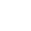
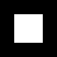
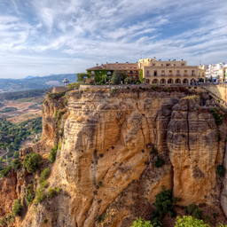
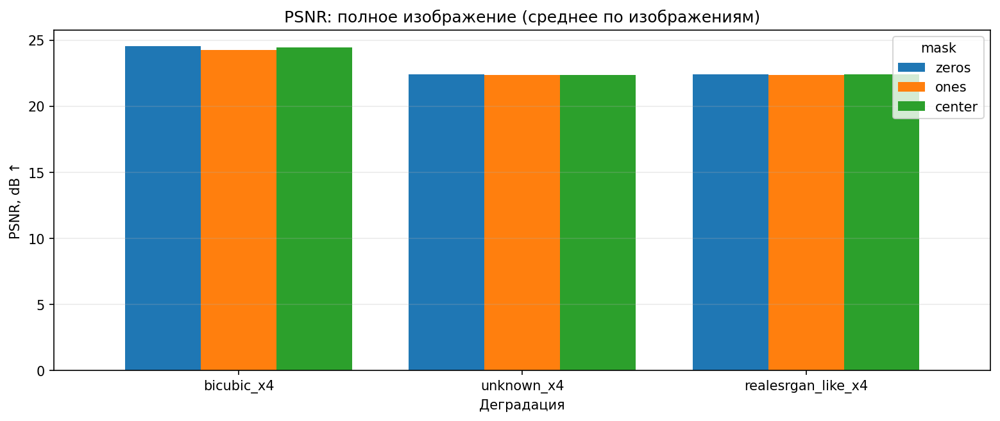
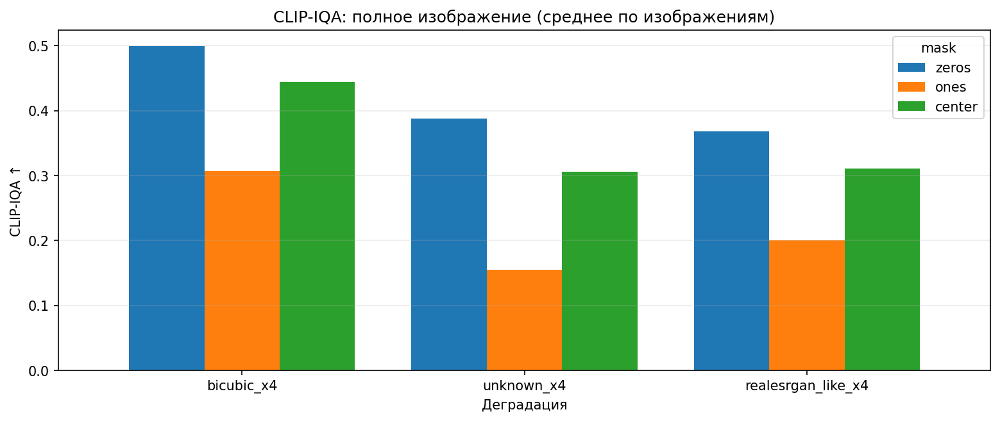
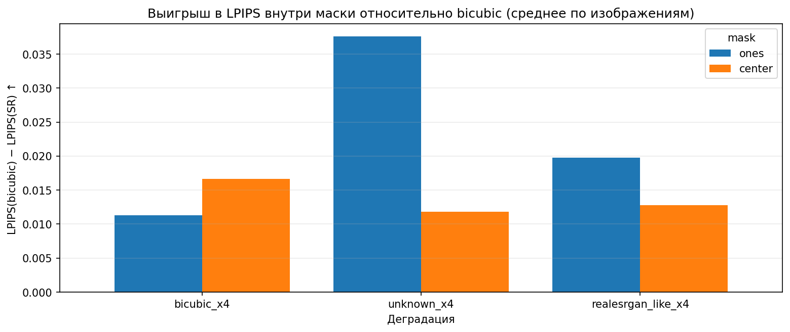
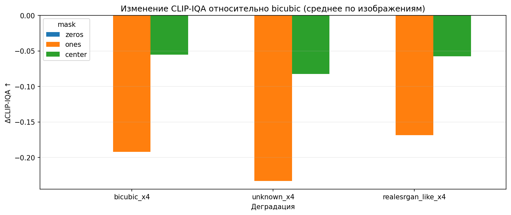
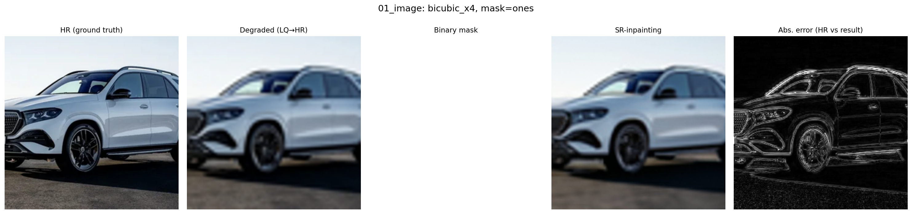
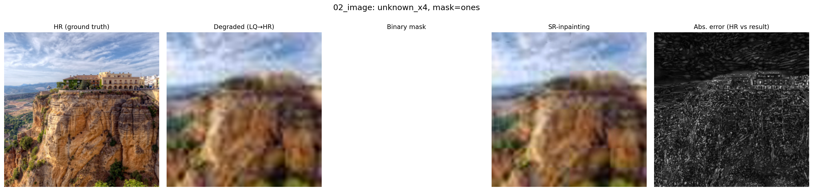
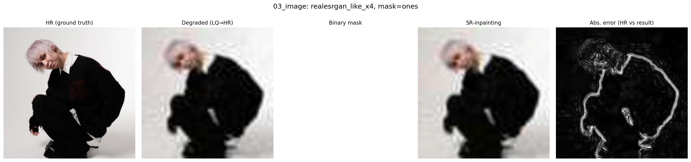

# Лабораторная работа 3. Сверхразрешение по маске (SR-inpainting)

**Цель работы:** разобраться в устройстве диффузионных image-to-image моделей и модифицировать процесс сэмплинга так, чтобы сверхразрешение применялось только к области, заданной бинарной маской.

В работе используется предобученная модель Stable Diffusion x4 Upscaler. Внутри маски изображение восстанавливается диффузионной моделью, за её пределами сохраняется результат bicubic-интерполяции. Для уменьшения вымышленных деталей используется частичное зашумление латентов исходного изображения и смешивание результата с bicubic.

## Запуск

Работа реализована в Jupyter Notebook для Google Colab. Для выполнения рекомендуется GPU с поддержкой CUDA.

1. Открыть ноутбук в Google Colab.
2. Выбрать среду выполнения с GPU.
3. Выполнить ячейки установки зависимостей и загрузки модели.
4. Загрузить три исходных изображения или собственный набор фотографий.
5. Выполнить ячейки подготовки деградаций, восстановления, вычисления метрик и визуализации.
6. Скачать архив результатов и распаковать его в папку `CV3_results` рядом с `README.md`.

Основные библиотеки: PyTorch, Diffusers, Transformers, Pillow, NumPy, pandas, matplotlib и PyIQA.

Параметры прогона приведены в [config.json](CV3_results/config.json).

| Параметр | Значение |
|---|---|
| Модель | `stabilityai/stable-diffusion-x4-upscaler` |
| Планировщик | DDIMScheduler |
| HR / LQ | 256×256 / 64×64 |
| Масштаб | ×4 |
| STEPS | 50 |
| GUIDANCE | 2.0 |
| NOISE_LEVEL | 5 |
| STRENGTH | 0.4 |
| BLEND_ALPHA | 0.85 |
| SEED | 42 |

Промпт: `photograph, faithful structure, natural textures`.

Негативный промпт: `distorted geometry, painting, artificial textures, oversaturation, artifacts`.

## 1. Теоретическая база

Диффузионная модель учится удалять шум из изображения. В прямом процессе к исходному представлению постепенно добавляется гауссов шум:

$$
z_t=\sqrt{\bar{\alpha}_t}z_0+\sqrt{1-\bar{\alpha}_t}\varepsilon,
\qquad \varepsilon\sim\mathcal N(0,I).
$$

В обратном процессе нейронная сеть предсказывает шум, а планировщик последовательно обновляет латенты. В работе используется DDIM — метод сэмплинга, позволяющий выполнять восстановление за ограниченное число шагов.

Stable Diffusion x4 Upscaler относится к моделям латентной диффузии. VAE кодирует изображение в латентное пространство и декодирует восстановленные латенты обратно в RGB. UNet получает зашумлённые латенты, малое изображение в качестве дополнительного условия и текстовые эмбеддинги. Это позволяет увеличивать разрешение в четыре раза без обучения новой модели.

В отличие от обычной генерации из шума, здесь начальное состояние строится из латента bicubic-увеличения. Параметр `STRENGTH` определяет долю шагов, используемую для восстановления. При 50 шагах и strength 0.4 используется 20 шагов обратного процесса. Такая инициализация направлена на сохранение геометрии и композиции сцены.

SR-inpainting — локальное сверхразрешение. Маска $M$ определяет область восстановления: единица разрешает изменение, ноль сохраняет известную область. После каждого шага DDIM выполняется смешивание:

$$
z_{t-1}=M\odot z_{t-1}^{gen}+(1-M)\odot z_{t-1}^{known}.
$$

Здесь $z_{t-1}^{known}$ — латент bicubic-изображения, зашумлённый до соответствующего уровня. Подход основан на идее сохранения известной области из RePaint, но не является полной реализацией его алгоритма повторного сэмплинга.

После декодирования выполняется пиксельное смешивание:

$$
I_{out}=I_{base}+\lambda M\odot(I_{gen}-I_{base}),\qquad \lambda=0.85.
$$

Это позволяет ограничить изменения внутри маски и гарантировать сохранение пикселей вне неё.

Качество оценивается тремя метриками.

- **PSNR** — пиксельная близость результата к эталону. Чем выше, тем лучше. Для RGB-изображений с диапазоном 0–255: $PSNR=10\log_{10}(255^2/MSE)$.
- **LPIPS** — перцептивное расстояние между результатом и эталоном по признакам нейронной сети. Чем ниже, тем лучше.
- **CLIP-IQA** — безэталонная оценка визуального качества на основе CLIP. Чем выше, тем лучше по оценке модели; высокий балл не гарантирует совпадения с эталоном.

## 2. Описание разработанной системы

Система последовательно выполняет подготовку данных, создание деградаций и масок, диффузионное восстановление, оценку качества и сохранение результатов.

Для каждого исходного изображения формируется эталон HR размером 256×256 и три деградированных входа LQ размером 64×64. Каждый вход увеличивается до HR методом bicubic. Полученное изображение служит базовым результатом и источником известной области для сэмплинга.

Используются три типа деградации:

- `bicubic_x4` — уменьшение разрешения в четыре раза методом bicubic.
- `unknown_x4` — составная деградация, имитирующая неизвестный процесс ухудшения изображения.
- `realesrgan_like_x4` — синтетическая сложная деградация в духе Real-ESRGAN. Это не запуск модели Real-ESRGAN и не официальный набор DIV2K.

Используются три бинарные маски:

| Zeros — 0% | Ones — 100% | Center — 25% |
|---|---|---|
|  |  |  |

При нулевой маске возвращается bicubic-изображение. При полной маске восстанавливается весь кадр. При центральной маске изменяется только центральный квадрат, занимающий 25% площади. Для работы с латентами и RGB маска приводится к соответствующему пространственному разрешению.

Алгоритм восстановления:

1. Получить LQ и bicubic-базу.
2. Закодировать bicubic-базу с помощью VAE.
3. Сформировать зашумлённые латенты с учётом `STRENGTH`.
4. Выполнить шаги DDIM с условием на LQ и текст.
5. На каждом шаге заменить латенты вне маски известными латентами с соответствующим уровнем шума.
6. Декодировать латенты, смешать восстановление с bicubic внутри маски и сохранить исходную базу вне неё.
7. Рассчитать метрики относительно HR и сравнить их с bicubic.

Системные требования: Python, совместимые версии PyTorch и Diffusers, GPU с CUDA (рекомендуется), память для размещения модели и хранения результатов. Точная конфигурация видеокарты в архиве не зафиксирована.

## 3. Результаты работы и тестирования системы

Эксперимент проведён на трёх изображениях: автомобиль, скала с архитектурой и человек. Для каждого использованы три деградации и три маски. Всего получено 27 результатов, из которых 18 соответствуют ненулевой маске.

| Автомобиль | Скала и архитектура | Человек |
|---|---|---|
|  |  |  |

Полные результаты: [metrics.csv](CV3_results/metrics.csv), [summary.csv](CV3_results/summary.csv), [metrics_mean.csv](CV3_results/metrics_mean.csv).

### Средние метрики по всему изображению

В таблице приведены средние значения по трём изображениям для каждой комбинации деградации и маски.

| Деградация | Маска | PSNR, дБ ↑ | LPIPS ↓ | CLIP-IQA ↑ |
|---|---|---:|---:|---:|
| bicubic_x4 | zeros | 24.538 | 0.4416 | 0.4989 |
| bicubic_x4 | ones | 24.280 | 0.4303 | 0.3068 |
| bicubic_x4 | center | 24.450 | 0.4351 | 0.4436 |
| unknown_x4 | zeros | 22.401 | 0.6692 | 0.3883 |
| unknown_x4 | ones | 22.356 | 0.6316 | 0.1553 |
| unknown_x4 | center | 22.395 | 0.6646 | 0.3058 |
| realesrgan_like_x4 | zeros | 22.444 | 0.6504 | 0.3683 |
| realesrgan_like_x4 | ones | 22.353 | 0.6307 | 0.1999 |
| realesrgan_like_x4 | center | 22.413 | 0.6459 | 0.3106 |

Нулевая маска соответствует bicubic-базе. Для полной и центральной масок средний PSNR по каждой деградации немного снижается, а LPIPS уменьшается. При этом CLIP-IQA снижается для всех комбинаций ненулевой маски.

### Изменение метрик относительно bicubic

PSNR и LPIPS в следующей таблице рассчитаны внутри маски. CLIP-IQA рассчитана для полного кадра. Прирост LPIPS определяется как LPIPS baseline минус LPIPS result, поэтому положительное значение означает улучшение.

| Деградация | Маска | ΔPSNR, дБ ↑ | Прирост LPIPS ↑ | ΔCLIP-IQA ↑ |
|---|---|---:|---:|---:|
| bicubic_x4 | ones | -0.2584 | +0.0113 | -0.1921 |
| bicubic_x4 | center | -0.2440 | +0.0166 | -0.0553 |
| unknown_x4 | ones | -0.0447 | +0.0376 | -0.2330 |
| unknown_x4 | center | -0.0165 | +0.0118 | -0.0825 |
| realesrgan_like_x4 | ones | -0.0911 | +0.0197 | -0.1684 |
| realesrgan_like_x4 | center | -0.0939 | +0.0128 | -0.0578 |

По 18 опытам с ненулевой маской среднее изменение PSNR внутри маски составило −0.125 дБ, средний прирост LPIPS — +0.0183, изменение CLIP-IQA — −0.1315. PSNR вырос в 2 из 18 опытов, LPIPS улучшился в 16 из 18, CLIP-IQA не вырос ни в одном.

Наибольший средний прирост LPIPS наблюдается у `unknown_x4` с полной маской (+0.0376). При этом снижение PSNR невелико (−0.0447 дБ). Это показывает, что перцептивная близость к эталону может улучшаться без существенной потери пиксельной точности, но не означает улучшения по всем критериям.

### Проверка работы масок

При `zeros` результат полностью совпадает с bicubic. При `center` все пиксели за пределами центральной области также совпадают с bicubic. Для всех 18 опытов, где существует область вне маски, `MAE_outside_vs_bicubic = 0`. Это подтверждено непосредственным сравнением сохранённых PNG-файлов.

Для полной маски область вне маски отсутствует, а для нулевой маски отсутствует область восстановления. Соответствующие неприменимые метрики записаны как NaN, а не как нулевые значения.

### Визуальные результаты

На каждом сравнении слева направо показаны эталон HR, деградированное изображение после bicubic-увеличения, маска, результат SR-inpainting и карта абсолютной ошибки относительно эталона.

На автомобиле можно оценить сохранение контуров кузова и колёс при разных масках. При полной маске восстановление применяется ко всему изображению, при центральной — только к заданной области.

На скале с архитектурой при сложных деградациях остаётся заметное размытие мелких деталей. Восстановление сохраняет общую композицию, но не возвращает полностью текстуру скалы и архитектурные элементы.

На изображении человека при RealESRGAN-like деградации сохраняются силуэт и композиция, но мелкие детали лица и одежды восстановлены не полностью.

Все 27 сравнений доступны в [comparisons/](CV3_results/comparisons/), восстановленные изображения — в [outputs/](CV3_results/outputs/).

## 4. Выводы

В ходе работы реализован алгоритм локального диффузионного сверхразрешения на основе Stable Diffusion x4 Upscaler с модифицированным сэмплингом DDIM. Проведено 27 экспериментов на трёх изображениях с тремя деградациями и тремя бинарными масками.

Модификация сэмплинга и финальное пиксельное смешивание позволяют ограничить восстановление заданной областью. При нулевой и центральной масках ошибка относительно bicubic за пределами маски равна нулю.

Частичное зашумление исходных латентов и ограниченное смешивание направлены на сохранение исходной структуры. Полученные результаты показывают уменьшение LPIPS в большинстве опытов при небольшом среднем снижении PSNR. Однако CLIP-IQA ухудшается, а на сложных деградациях остаётся размытие. Поэтому нельзя утверждать, что модель превосходит bicubic по всем критериям.

Основное ограничение подхода — компромисс между восстановлением деталей и сохранением исходной структуры. Для дальнейшего улучшения необходим подбор strength, guidance, noise level и коэффициента смешивания на более широком наборе изображений. SUPIR в данном эксперименте не использовалась; сравнение с ней не проводилось.

## 5. Использованные источники

1. Ho J., Jain A., Abbeel P. [Denoising Diffusion Probabilistic Models](https://arxiv.org/abs/2006.11239). 2020.
2. Song J., Meng C., Ermon S. [Denoising Diffusion Implicit Models](https://arxiv.org/abs/2010.02502). 2020.
3. Rombach R. et al. [High-Resolution Image Synthesis with Latent Diffusion Models](https://arxiv.org/abs/2112.10752). 2022.
4. Lugmayr A. et al. [RePaint: Inpainting using Denoising Diffusion Probabilistic Models](https://arxiv.org/abs/2201.09865). 2022.
5. Stability AI. [Stable Diffusion x4 Upscaler](https://huggingface.co/stabilityai/stable-diffusion-x4-upscaler).
6. Wang X. et al. [Real-ESRGAN: Training Real-World Blind Super-Resolution with Pure Synthetic Data](https://arxiv.org/abs/2107.10833). 2021.
7. Zhang R. et al. [The Unreasonable Effectiveness of Deep Features as a Perceptual Metric](https://arxiv.org/abs/1801.03924). 2018.
8. Wang J., Chan K. C. K., Loy C. C. [Exploring CLIP for Assessing the Look and Feel of Images](https://arxiv.org/abs/2207.12396). 2023.
9. [Hugging Face Diffusers](https://github.com/huggingface/diffusers).
10. [PyIQA: Image Quality Assessment Toolbox](https://github.com/chaofengc/IQA-PyTorch).
